# Application code map

All paths below exist. Verification commands run from the repo root using the
virtual environment. `python scripts/check.py full` verifies the entire slice;
`coverage` additionally checks application statement/branch coverage.

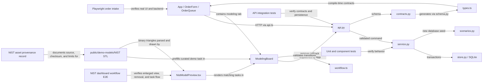

## Source and test responsibilities

| File | Owned behavior / relationships | Verification |
| --- | --- | --- |
| [backend/print_assist/__init__.py](../backend/print_assist/__init__.py) | Package marker; no initialization side effects. | Backend suite/imports |
| [contracts.py](../backend/print_assist/contracts.py) | Strict quantity/priority, UTC deadlines, typed printer/material, visual metadata, printer/reset commands and entity-linked activity schema. Used by API/service and generated frontend types. | `python -m pytest backend/tests/integration` |
| [scenarios.py](../backend/print_assist/scenarios.py) | Deterministic seeded/empty-order baselines with three idle virtual printers, print-ready artifact and disabled controls. | Service/production-controls tests |
| [store.py](../backend/print_assist/store.py) | SQLite transactions, snapshot storage, command-result table and connection lifetime. | Store/service tests |
| [service.py](../backend/print_assist/service.py) | One-owner transactional intake/production, session/revision/replay checks, atomic reset and current-reset receipt lifetime. | Service and production-controls tests |
| [scheduling.py](../backend/print_assist/scheduling.py) | Deterministic automatic/manual assignment, blocked explanations, assignment events and material-revalidated start/resume. | Scheduling and controls unit tests |
| [simulation.py](../backend/print_assist/simulation.py) | Deterministic eligible-printer progression, completion events and bounded material consumption; paused/offline work is frozen. | Scheduling and controls unit tests |
| [api.py](../backend/print_assist/api.py) | Offline app factory, typed intake/modeling/production/control/reset routes and conflict responses. | `python -m pytest backend/tests/integration` |
| [backend/tests/conftest.py](../backend/tests/conftest.py) | Shared order fixture and outbound socket guard (numeric loopback allowed). | Backend suite |
| [test_orders.py](../backend/tests/unit/test_orders.py) | Invalid inputs and normalized/equal-boundary deadlines. | Backend unit suite |
| [test_scheduling.py](../backend/tests/unit/test_scheduling.py) | Initial scheduling priority and distinct-printer behavior. | `python -m pytest backend/tests/unit/test_scheduling.py` |
| [test_service.py](../backend/tests/unit/test_service.py) | Persistence, replay, unknown artifacts, concurrent conflicts, detached snapshots and restart invalidation. | Backend unit suite |
| [test_store.py](../backend/tests/unit/test_store.py) | Transaction exit closes a real SQLite connection. | Backend unit suite |
| [test_checks.py](../backend/tests/unit/test_checks.py) | Root runner executes subprocesses and propagates failure without continuing. | Backend unit suite |
| [test_orders_api.py](../backend/tests/integration/test_orders_api.py) | Real app/SQLite HTTP behavior, response schema, offline operation with fake credentials. | Backend integration suite |
| [frontend/src/main.tsx](../frontend/src/main.tsx) | DOM mounting and stylesheet import only. | Browser test/build |
| [App.tsx](../frontend/src/App.tsx) | Dashboard tabs, state loading, control/reset composition, retry ownership and late-response suppression across session replacement. Delegates 3D views to PrinterFloor. | Frontend App tests |
| [api.ts](../frontend/src/api.ts) | HTTP transport and actionable save/load errors. | Frontend transport tests |
| [types.ts](../frontend/src/types.ts) | Generated OpenAPI types; do not hand-edit. | `python scripts/schema.py --check` |
| [styles.css](../frontend/src/styles.css) | Responsive layout for intake, modeling, queue, support review, removal actions, enlarged model preview, and 3D printer/control panels. No business logic. | Build/browser review |
| [OrderForm.tsx](../frontend/src/components/OrderForm.tsx) | Inputs with icon-triggered tooltips and examples, UTC command payload, busy/error states, preservation on failure. | Frontend OrderForm tests |
| [OrderQueue.tsx](../frontend/src/components/OrderQueue.tsx) | Empty state, saved quantity/deadlines/status and completion display. | Frontend OrderQueue tests |
| [test-setup.ts](../frontend/src/test-setup.ts) | DOM cleanup, mock restoration and default fetch denial. | Frontend suite |
| [test-fixtures.ts](../frontend/src/test-fixtures.ts) | Complete typed empty/ordered snapshot fixtures. | Frontend suite/typecheck |
| [App.test.tsx](../frontend/src/App.test.tsx) | Load/save/refresh, control/reset retries, cross-session overlapping reads/mutations, retry-key preservation and stale success/failure handling. | `npm test` |
| [api.test.ts](../frontend/src/api.test.ts) | Transport command body and load/conflict/validation errors. | `npm test` |
| [OrderForm.test.tsx](../frontend/src/components/OrderForm.test.tsx) | Field explanations, submit payload, rejected-input preservation and invalid deadline feedback. | `npm test` |
| [OrderQueue.test.tsx](../frontend/src/components/OrderQueue.test.tsx) | Empty and saved order presentation. | `npm test` |
| [scripts/check.py](../scripts/check.py) | Portable unit/full/coverage orchestration; short-circuits on failure; per-run outputs. | Runner unit tests and all three check modes |
| [scripts/schema.py](../scripts/schema.py) | Offline OpenAPI generation, TS generation and drift check in temporary storage. | Full/coverage modes |
| [order-intake.spec.ts](../tests/e2e/order-intake.spec.ts) | Browser-to-real-backend creation and reload persistence; fails external requests. | `npm run e2e` |
| [modeling-dashboard.spec.ts](../tests/e2e/modeling-dashboard.spec.ts) | Verifies NIST preview gestures, Snack Sticks page-reference intake, support assessment with removal notes, combined review, revision persistence, paired approval, removal confirmation, order selection, and zero external requests. | `npm run e2e` |

## Production controls and reset

| File | Owned behavior / relationships | Verification |
| --- | --- | --- |
| [activity.py](../backend/print_assist/activity.py) | Entity-linked production events and repeated blocked-reason suppression, shared by controls/scheduling/simulation/reset. | Controls unit tests |
| [controls.py](../backend/print_assist/controls.py) | Pure pause/resume/offline/online transitions; preserves held attempts and requires explicit resume after coming online. | `python -m pytest backend/tests/unit/test_controls.py` |
| [test_controls.py](../backend/tests/unit/test_controls.py) | Frozen progress/stock, pending manual work, valid and rejected transitions, resume validation, material accounting and assignment explanations. | Backend unit suite |
| [test_production_controls.py](../backend/tests/integration/test_production_controls.py) | Typed API/replay/atomicity, concurrent reset and assignment, receipt retirement, fresh inventory/custom data and disabled flags. | Backend integration suite |
| [ProductionControls.tsx](../frontend/src/components/ProductionControls.tsx) | State-specific printer actions, acknowledged scenario replacement, newest-first activity and legacy event compatibility. | ProductionControls component tests |
| [ProductionControls.test.tsx](../frontend/src/components/ProductionControls.test.tsx) | Allowed actions, busy/failure states, reset acknowledgment and readable old/new events. | `npm test --workspace frontend -- src/components/ProductionControls.test.tsx` |
| [production-controls.spec.ts](../tests/e2e/production-controls.spec.ts) | Real seeded/manual workflow, paused/offline stock preservation, explicit resume, full requested quantity completion and empty reset without external requests. | Root full/coverage checks |

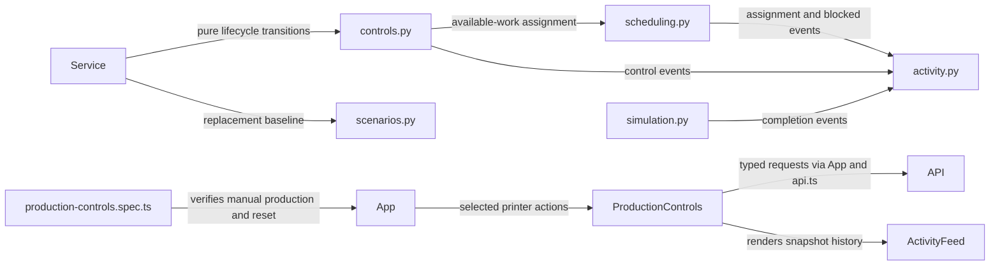

## Configuration and documentation

| File | Responsibility | Verification |
| --- | --- | --- |
| [.gitignore](../.gitignore) | Exclude credentials, runtime data, tools, caches and generated outputs. | Git status/check-ignore |
| [.node-version](../.node-version) | Reference Node version. | `node --version` |
| [.python-version](../.python-version) | Reference Python version. | `python --version` |
| [pyproject.toml](../pyproject.toml) | Runtime/test dependencies, pytest paths, application coverage gate. | Locked sync/backend checks |
| [uv.lock](../uv.lock) | Resolved Python versions/hashes. | `uv sync --locked --extra test` |
| [package.json](../package.json) | npm workspace commands and browser/schema dependencies. | `npm ci`, full checks |
| [package-lock.json](../package-lock.json) | Resolved JS versions/integrities. | `npm ci` |
| [frontend/package.json](../frontend/package.json) | React/Vite/TypeScript and component testing dependencies/scripts. | npm tests/build |
| [frontend/tsconfig.json](../frontend/tsconfig.json) | Strict TS/browser compilation. | `npm run build` |
| [frontend/vite.config.ts](../frontend/vite.config.ts) | Loopback dev server/API proxy (ports can be overridden for parallel local runs), DOM tests and coverage inclusion/exclusion. | Full/coverage checks |
| [frontend/index.html](../frontend/index.html) | Browser title, responsive viewport and mount entry. | Browser test/build |
| [playwright.config.ts](../playwright.config.ts) | Test-owned backend/frontend servers (ports can be overridden), separate DB/output per run. | Browser test and clean exit |
| [development.md](development.md) | Setup, startup/restart, check commands, coverage scope and platform verification matrix. | Links and agreement with executed commands |

## Modeling workflow

| File | Responsibility | Verification |
| --- | --- | --- |
| [ModelingBoard.tsx](../frontend/src/dashboard/ModelingBoard.tsx) | Operator-facing persisted board with distinct model and linked support-assessment tasks, optional support file/material/removal details, combined review and approval handoff, task removal, order-use checks, conditional NIST preview, and a linked Snack Sticks support demo page. Does not generate support geometry or slice files. | ModelingBoard tests, NistModelPreview, workflow module |
| [NistModelPreview.tsx](../frontend/src/dashboard/NistModelPreview.tsx) | Loads and validates the bundled binary STL, renders shaded triangles, opens a high-resolution enlarged dialog on click, supports mouse-drag rotation and independent pinch zoom only in that dialog, preserves rotate/reset buttons, and explains NIST artifact features. | `ModelingBoard.test.tsx`, modeling dashboard browser workflow |
| [workflow.ts](../frontend/src/dashboard/workflow.ts) | Validates model tasks, linked support assessments, required-support and no-support paths into combined review, approval, and revision return. Backend owns persistence in the integrated app. | `workflow.test.ts` |
| [ModelingBoard.test.tsx](../frontend/src/dashboard/ModelingBoard.test.tsx) | Verifies support assessment and optional support details, combined review, paired approval, no-support path to review, revision return, removal guards, and NIST preview gestures. | `npm test` |
| [public/demo-models/nist-test-artifact.stl](../frontend/public/demo-models/nist-test-artifact.stl) | Bundled NIST public-domain STL served as a modeling dashboard demo download. | ModelingBoard tests and browser workflow; verify checksum against asset record |
| [public/demo-models/README.md](../frontend/public/demo-models/README.md) | NIST source, public-domain notice, checksum, local mesh check, and demo-estimate caveat. | Check source URL and checksum against bundled asset. |
| [workflow.test.ts](../frontend/src/dashboard/workflow.test.ts) | Verifies required inputs, allowed transitions, and invalid action rejection. | `npm test` |

Return to the [repository map](knowledge-map.md) for requirements and research.

## Modeling production handoff

| File | Responsibility | Verification |
| --- | --- | --- |
| [modeling.py](../backend/print_assist/modeling.py) | Validated linked support-task assessment, combined review, paired model/support artifact approval, task removal, and order-use protection. | `python -m pytest backend/tests/integration/test_modeling.py` |
| [test_modeling.py](../backend/tests/integration/test_modeling.py) | Persists model and support task together, requires an assessment, sends no-support models to review, validates revisions/removal, and verifies order intake. | `python -m pytest backend/tests/integration/test_modeling.py` |

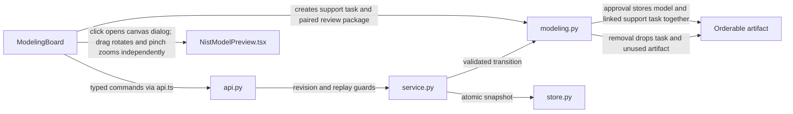

## Field help

| File | Responsibility | Verification |
| --- | --- | --- |
| [EntryField.tsx](../frontend/src/components/EntryField.tsx) | Shared input label and info icon; help hidden until hover, focus or tap; Escape dismisses; accessible field description. | `npm test --workspace frontend -- src/components/EntryField.test.tsx` |
| [EntryField.test.tsx](../frontend/src/components/EntryField.test.tsx) | Visibility, keyboard/touch activation, Escape dismissal, and non-submitting info button behavior. | `npm test --workspace frontend -- src/components/EntryField.test.tsx` |

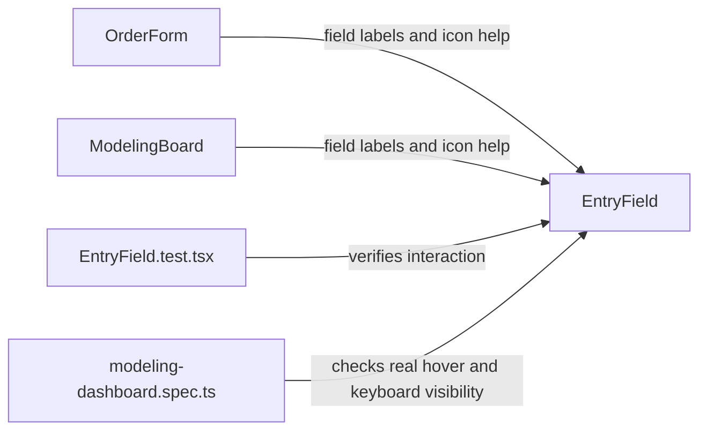

## Interactive printer views

| File | Owned behavior / relationships | Verification |
| --- | --- | --- |
| [visual_assets.py](../backend/print_assist/visual_assets.py) | Local STL catalog and visual-ID allowlist used by task validation and snapshot metadata. | `python -m pytest backend/tests/integration/test_modeling.py` |
| [model.ts](../frontend/src/printers/model.ts) | Resolves each printer's active/latest completed job, artifact and bounded progress. | `npm test --workspace frontend -- src/printers/model.test.ts` |
| [model.test.ts](../frontend/src/printers/model.test.ts) | Empty, unknown, active, completed and invalid progress view states. | Frontend suite |
| [assets.ts](../frontend/src/printers/assets.ts) | Bounded same-origin STL loading, geometry validation, explicit rotation, centering and volume warnings without rescaling. | `npm test --workspace frontend -- src/printers/assets.test.ts` |
| [assets.test.ts](../frontend/src/printers/assets.test.ts) | ASCII/binary parsing, units/orientation, bounds, byte/triangle limits and invalid assets. | Frontend suite |
| [scene.ts](../frontend/src/printers/scene.ts) | Procedural frame/bed/nozzle, idle demand rendering, activity-gated motion loop, clipping, orbit/camera commands, resize, context failure and GPU disposal. Three.js is third-party, bundled locally. | `npm test --workspace frontend -- src/printers/scene.test.ts` and real browser tests |
| [scene.test.ts](../frontend/src/printers/scene.test.ts) | Real Three geometry and cameras with fake GPU boundary: clipping, commands, resizing, empty/placeholder scenes, failure and disposal. | Frontend suite |
| [PrinterScene.tsx](../frontend/src/printers/PrinterScene.tsx) | Asynchronous asset lifecycle, stale-load disposal, fallback, fit warnings and accessible camera controls. | `npm test --workspace frontend -- src/printers/PrinterScene.test.tsx` |
| [PrinterScene.test.tsx](../frontend/src/printers/PrinterScene.test.tsx) | Empty/loaded/stale/failed/context-lost view behavior and unmount cleanup. | Frontend suite |
| [PrinterFloor.tsx](../frontend/src/printers/PrinterFloor.tsx) | Compact overview and selected detailed printer, optional production controls, model association and local example-progress controls. | PrinterFloor and App tests |
| [PrinterFloor.test.tsx](../frontend/src/printers/PrinterFloor.test.tsx) | Printer selection, example isolation, empty state and artifact progress. | Frontend suite |
| [example-tower.stl](../frontend/public/models/example-tower.stl) | Original deterministic stepped example mesh in millimeters/Z-up; no real production certification. | STL loader and browser checks |
| [Model handoff](../frontend/public/models/README.md) | Partner-facing instructions and asset provenance. | Link/catalog consistency review |
| [printer-views.spec.ts](../tests/e2e/printer-views.spec.ts) | Real WebGL, camera-change evidence, local STL, WebGL fallback and production/model association workflows. | `python scripts/check.py full` |

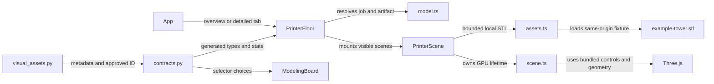

## Clock, forecasting and live monitoring

The clock follow-up extends api.py with a cancellable one-owner FastAPI lifespan
loop and typed clock route; service.py serializes fixed ticks and clock commands.
contracts.py/types.ts carry clock speed, Forecast and Telemetry contracts.
App.tsx connects Run/Pause/speed and polling; OrderQueue.tsx shows estimates,
risk and unavailable reasons; App.test.tsx covers these controls and legacy speed.
test-fixtures.ts includes clock speed. scenarios.py resets speed and pauses.
production-controls.spec.ts also verifies automatic progress via live polling.

| File | Purpose, relationships and verification |
| --- | --- |
| [monitoring.py](../backend/print_assist/monitoring.py) | Pure read projections: conservative shared printer/material forecasting and illustrative temperatures; API response projection. Verify with monitoring backend tests. |
| [test_monitoring.py](../backend/tests/unit/test_monitoring.py) | Forecast capacity, deadlines, holds, material; clock run/pause/replay/reset and real lifespan shutdown/restart. `python -m pytest backend/tests/unit/test_monitoring.py`. |
| [monitoring.ts](../frontend/src/monitoring.ts) | Recursive one-second polling, no overlapping automatic reads, ref-based latest callback and unmount cleanup. Verify monitoring hook tests. |
| [monitoring.test.tsx](../frontend/src/monitoring.test.tsx) | Fake-timer proof of non-overlap and cleanup. `npm test --workspace frontend -- src/monitoring.test.tsx`. |

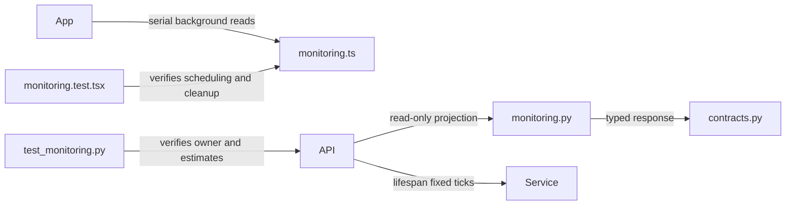

## Dashboard stability and readable identifiers

App.tsx/styles.css now own the dark compact dashboard shell, real summary metrics,
responsive floor/activity grid and stable panel sizes. PrinterFloor.tsx owns friendly
station headings, compact part references, progress bars and per-printer simulated
telemetry. ProductionControls.tsx uses friendly station labels and compact activity
references; backend command IDs remain unchanged. App/PrinterFloor/ProductionControls
component tests assert the new presentation and preserve command checks.

| File | Purpose, relationships and verification |
| --- | --- |
| [display.ts](../frontend/src/display.ts) | Presentation-only printer/part/short hexadecimal order labels, shared by App, PrinterFloor and ProductionControls. Verify display unit tests. |
| [display.test.ts](../frontend/src/display.test.ts) | Friendly, custom and long-ID label examples. `npm test --workspace frontend -- src/display.test.ts`. |
| [PrinterScene.tsx](../frontend/src/printers/PrinterScene.tsx) | Asset metadata identity controls loading; live progress/color update the existing scene without resetting cameras. Async stale-load cleanup remains. Verify PrinterScene tests. |
| [scene.ts](../frontend/src/printers/scene.ts) | Incremental clipping/material/nozzle updates preserve renderer, mesh and camera; geometry is disposed only on scene replacement/unmount. Verify scene tests. |
| [PrinterScene.test.tsx](../frontend/src/printers/PrinterScene.test.tsx) | Equal metadata snapshots reuse renderer/load and apply latest progress/color; existing stale/unmount/fallback cases. Frontend suite. |
| [scene.test.ts](../frontend/src/printers/scene.test.ts) | Live clipping update preserves camera/canvas, plus empty/placeholder/disposed updates. Frontend suite. |
| [printer-views.spec.ts](../tests/e2e/printer-views.spec.ts) | Real canvas identity and floor height survive refresh; existing WebGL/camera/asset workflows. Root full/coverage checks. |

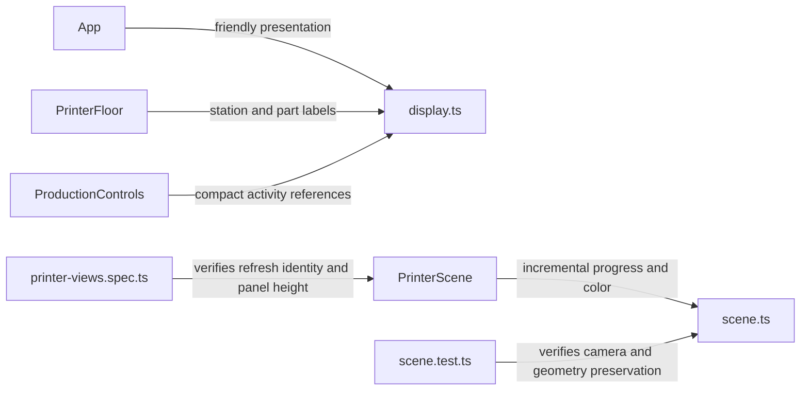

## Guided model-to-print workflow

contracts.py/types.ts add PlanOrderCommand/Payload; api.py exposes atomic
`/api/orders/plan`; service.py validates approved artifacts, creates an order,
assigns jobs, preserves prior manual modes and starts the clock for automatic work.
simulation.py now prepares subsequent manual batches as pending, without starting.
App.tsx owns tab guidance, approved-profile selection and existing guarded command
retry ownership. PrinterFloor.tsx selects cards/headers and shares inspection,
pending start and controls across Overview/Printers. PrinterScene.tsx forwards
clock/job activity; scene.ts animates illustrative head motion with visibility,
pause and disposal cancellation. ModelingBoard.tsx imports prepared profile metadata,
hides technical prep fields and links approved models to Orders. styles.css owns
inspector/guidance/import presentation. Tests in the existing component/scene/App
files cover selection, motion cancellation and profile/quantity navigation.

| File | Responsibility / related behavior | Verification |
| --- | --- | --- |
| [QuickPrint.tsx](../frontend/src/components/QuickPrint.tsx) | Approved-profile selection, read-only per-part estimates, quantity, explicit editable demo deadlines and automatic/manual atomic plan payload. Composed by App. | QuickPrint tests and guided browser workflow |
| [QuickPrint.test.tsx](../frontend/src/components/QuickPrint.test.tsx) | Modes, inherited metadata, unavailable models, model selection, date validation and retry-preserved choices. | Frontend suite |
| [profile.ts](../frontend/src/dashboard/profile.ts) | Validates JSON profile fields/estimates and internal default virtual-printer compatibility; ModelingBoard imports metadata only. | Profile tests |
| [profile.test.ts](../frontend/src/dashboard/profile.test.ts) | Complete/invalid metadata, positive estimates and compatibility/preview shape validation. | Frontend suite |
| [test_quick_print.py](../backend/tests/integration/test_quick_print.py) | Atomic order planning, unknown-model rollback, replay, automatic clock and preservation of existing manual modes. | Backend integration suite |
| [example-tower.profile.json](../frontend/public/models/example-tower.profile.json) | Downloadable example metadata with explicitly illustrative demo estimates and registered preview. | JSON validation and guided browser profile import |
| [guided-printing.spec.ts](../tests/e2e/guided-printing.spec.ts) | Prepared decimal-weight profile approval, selected-model handoff, manual Overview start/pause/resume and automatic quantity navigation without external traffic. | Root full/coverage checks |

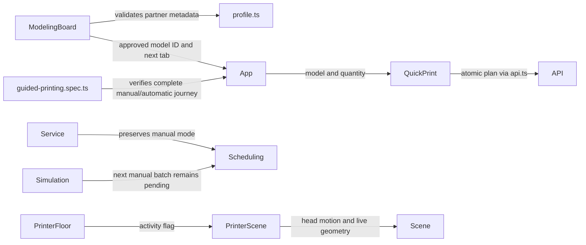

App/api.ts additionally handle one bounded refresh/retry for a clock pause rejected
by a known 409 revision conflict; ambiguous network failures retain their original
retry envelope, and changed/superseded sessions are never retried. App tests cover
pause success, changed session and reset while the conflict refresh is pending.

QuickPrint's navigation is also scoped to its source session, so a delayed result
cannot switch tabs after reset; App.test.tsx verifies that regression.

## Compact overview structure

App.tsx now owns the compact header/clock and toolbar, primary floor above a
queue/activity split, and right sidebar with acknowledged scenario reset,
workflow guidance and an explicit future-orchestration note. It shares selected
printer state across Overview/Printers. PrinterFloor.tsx accepts optional controlled
selection while retaining standalone defaults; its inspector is the single
selected-printer telemetry strip. Repeated card metrics are removed. PrinterScene.tsx
keeps camera controls in a disclosure (collapsed in compact mode); scene identity
and live rendering are unchanged. OrderQueue.tsx adds compact table presentation
with existing order totals, assigned part/printer references, deadlines and forecasts.
styles.css sets 76px header, 1720px maximum width, 345/310px sidebar, bounded lower
panels and mobile stacking. No backend contracts or simulation behavior changes.

| File | Responsibility / related behavior | Verification |
| --- | --- | --- |
| [OrderQueue.test.tsx](../frontend/src/components/OrderQueue.test.tsx) | Existing detailed intake display plus compact model/part/printer table. | Frontend suite |
| [App.test.tsx](../frontend/src/App.test.tsx) | Header/sidebar/bottom structure, cross-tab selected printer, sidebar reset, overview and detailed manual controls. | Frontend suite |
| [PrinterScene.test.tsx](../frontend/src/printers/PrinterScene.test.tsx) | Camera disclosure preserves expansion across progress updates, in addition to scene lifecycle checks. | Frontend suite |
| [overview-layout.spec.ts](../tests/e2e/overview-layout.spec.ts) | Real desktop panel alignment/header height, single telemetry strip, selection retention, camera disclosure, tablet stacking and mobile overflow checks. | Root full/coverage checks |

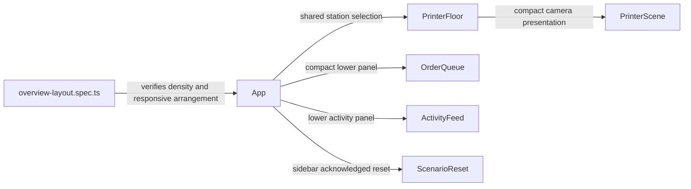

The guided-printing browser scenario pauses the clock before creating another
order, then lets automatic planning restart it; test mutations remain deterministic
under the existing revision guard. Compact rows disclose timing details rather
than expanding every row, and unassigned work has an explicit station label.

## Reviewable scheduling, reservations and idle start guidance

contracts.py/types.ts add typed proposals, assignments, blocked quantities,
apply commands and aggregate material commitments. api.py exposes read-only
GET /api/schedule/proposal and guarded POST /api/schedule/apply. service.py
uses snapshot-based preview and existing transactional revision/receipt guards
for apply. scheduling.py dispatches planned attempts before assigning more work,
counts them against requested quantity and excludes their committed material.
monitoring.py exposes the derived ledger and respects queued manual dependencies.
App.tsx wires preview/apply through existing uncertain-command receipt handling,
Overview guidance and idle-printer links to Orders. PrinterFloor.tsx exposes that
link in both views. QuickPrint.tsx selects automatic playback speed (60x default);
plan_order applies the explicitly chosen speed, avoiding inherited fast playback.
styles.css owns readiness/review presentation. Existing App, QuickPrint and API
integration tests cover navigation and inherited-fast-clock behavior.

| File | Owned behavior / relationships | Verification |
| --- | --- | --- |
| [proposals.py](../backend/print_assist/proposals.py) | Pure priority/deadline/ID future capacity allocation, held-equipment exclusion, blocked quantities, deterministic state hash and validated creation of planned attempts. | Proposal unit and API tests |
| [reservations.py](../backend/print_assist/reservations.py) | Remaining filament commitments for planned/pending/running/paused attempts; free stock and aggregate ledger derive once from unique attempts, without reservation-time stock deduction. | Proposal lifecycle/API tests |
| [test_proposals.py](../backend/tests/unit/test_proposals.py) | Read-only deterministic future plans, full/partial material capacity, held/manual dependencies, pending dispatch, offline preservation and exact consumption. | Backend unit suite |
| [test_schedule_proposals_api.py](../backend/tests/integration/test_schedule_proposals_api.py) | Preview purity, typed modes, stale apply/reset rejection, receipt replay and competing applies reserving once. | Backend integration suite |
| [PrintingGuidance.tsx](../frontend/src/components/PrintingGuidance.tsx) | Empty/completed, waiting, running and paused-clock explanations with new-print and scheduling links. | PrintingGuidance/App tests |
| [PrintingGuidance.test.tsx](../frontend/src/components/PrintingGuidance.test.tsx) | Real work/clock state messaging and navigation callbacks. | Frontend suite |
| [ScheduleProposal.tsx](../frontend/src/components/ScheduleProposal.tsx) | Preview/apply UI, future slots/material/blocked work, assumptions, stale guards, mode locking during requests, error feedback and commitment display. | ScheduleProposal/App tests |
| [ScheduleProposal.test.tsx](../frontend/src/components/ScheduleProposal.test.tsx) | Preview/apply, stale/read failures, blocked/empty/manual plans, ledger and mode lock. | Frontend suite |
| [schedule-proposals.spec.ts](../tests/e2e/schedule-proposals.spec.ts) | Idle new-print journey, real animated pixel change, pause/resume, read-only future proposal, apply/stock commitments and completion with released reservations. | Root full/coverage suite |

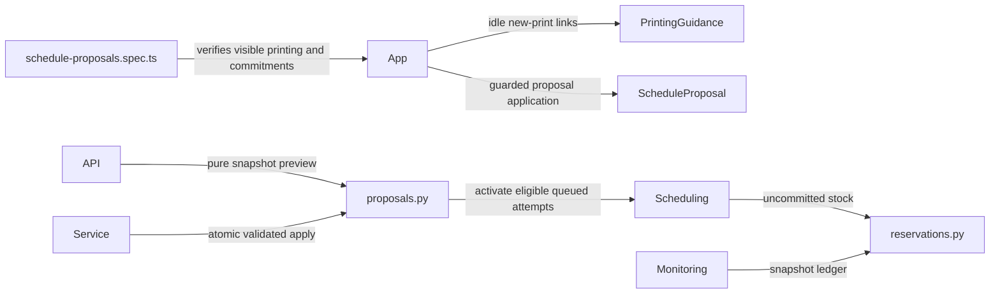

Review-first intake uses PlanOrderPayload.review_only and Order.requires_schedule_review.
The service persists the hold atomically; automatic/manual schedulers skip it until
application, while already approved planned attempts can run. Partial application
keeps unassigned quantities held. QuickPrint/App carry the selected playback speed
to ScheduleProposal and ApplySchedulePayload; automatic apply honors it. Tests cover
holding through clock advancement, partial approval/online capacity changes and speed.

## Published modeling/support integration

GitHub main 3b01bbd adds linked support assessment/review records, support metadata
on approved artifacts, removal guards, a bundled NIST modeling preview and
configurable test ports. The combined App/ModelingBoard retains profile imports,
preparation-only fields, guarded modeling envelopes and Next: choose quantity.
Contracts/types preserve all clock, proposal and material reservation additions.
modeling.py/service.py initialize missing legacy support assessments on restart:
unassessed Supports/Review tasks return to pending Supports; approved history is
preserved and the UI labels absent legacy assessments instead of inventing them.
visual_assets.py registers the NIST mesh; assets.ts allows that exact bundled path
through the existing byte/triangle/geometry limits. The NIST demo uses blue PLA to
match virtual inventory, keeping its time/weight explicitly demo assumptions.
The combined styles retain the compact dark dashboard. Test/preview ports remain
configurable through the imported Vite/Playwright configuration.

| File | Purpose / relationships | Verification |
| --- | --- | --- |
| [test_modeling_upgrade.py](../backend/tests/integration/test_modeling_upgrade.py) | Restart compatibility for older modeling tasks and linked NIST approval-to-print path with default inventory. | Backend integration suite |
| [Modeling support integration plan](superpowers/plans/2026-11-14-modeling-support-integration.md) | Integration decisions, preservation boundaries and test requirements. | Root coverage and review |

Existing NistModelPreview.tsx/demo asset/provenance entries above describe the
imported standalone 2D mesh preview. PrinterScene still owns interactive printer
beds; browser canvas assertions explicitly target their .printer-canvas host.
ModelingBoard/asset tests additionally cover the blue profile, exact bounded NIST
path and legacy unknown-support labels. No CAD/support generation or inference
is added by this integration.

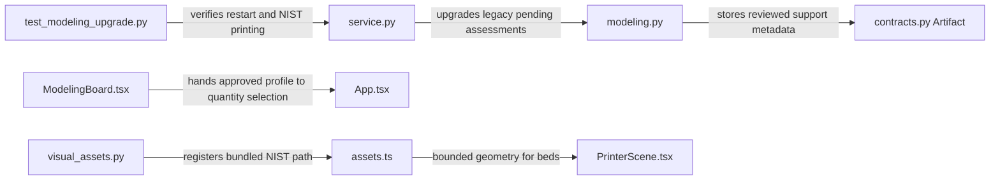
