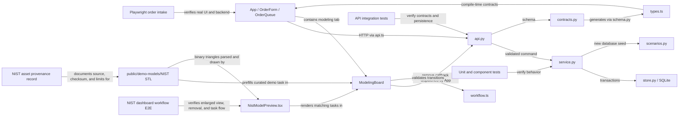
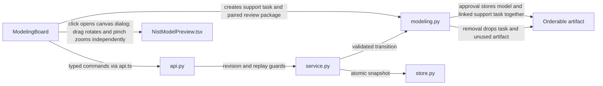
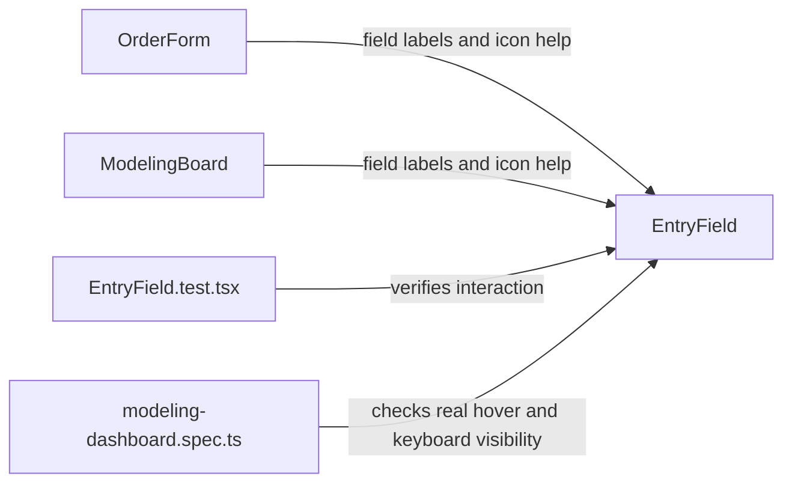
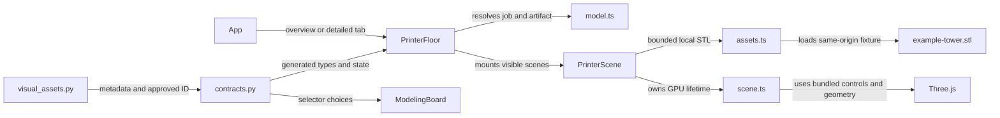

# Application code map

All paths below exist. Verification commands run from the repo root using the
virtual environment. `python scripts/check.py full` verifies the entire slice;
`coverage` additionally checks application statement/branch coverage.

## Source and test responsibilities

| File | Owned behavior / relationships | Verification |
| --- | --- | --- |
| [backend/print_assist/__init__.py](../backend/print_assist/__init__.py) | Package marker; no initialization side effects. | Backend suite/imports |
| [contracts.py](../backend/print_assist/contracts.py) | Strict order/printer contracts, visual asset metadata and validation, linked support-task records, and paired model/support artifacts. Used by API/service and generated frontend types. | Backend integration suite and `python scripts/schema.py --check` |
| [scenarios.py](../backend/print_assist/scenarios.py) | Deterministic empty-orders seed with three idle virtual printers and one print-ready artifact reference. | Service/API tests |
| [store.py](../backend/print_assist/store.py) | SQLite transactions, snapshot storage, command-result table and connection lifetime. | Store/service tests |
| [service.py](../backend/print_assist/service.py) | One-owner authoritative intake, legacy printer-state initialization, session/revision checks, idempotency and atomic order/events. | `python -m pytest backend/tests/unit/test_service.py` |
| [scheduling.py](../backend/print_assist/scheduling.py) | Deterministic automatic/manual assignment and manual start/resume transitions. | `python -m pytest backend/tests/unit/test_scheduling.py` |
| [simulation.py](../backend/print_assist/simulation.py) | Deterministic print progression, completion and material use. | `python -m pytest backend/tests/unit/test_scheduling.py` |
| [api.py](../backend/print_assist/api.py) | Offline app factory, state, order, schedule, start and advance routes and conflict responses. | `python -m pytest backend/tests/integration` |
| [backend/tests/conftest.py](../backend/tests/conftest.py) | Shared order fixture and outbound socket guard (numeric loopback allowed). | Backend suite |
| [test_orders.py](../backend/tests/unit/test_orders.py) | Invalid inputs and normalized/equal-boundary deadlines. | Backend unit suite |
| [test_scheduling.py](../backend/tests/unit/test_scheduling.py) | Initial scheduling priority and distinct-printer behavior. | `python -m pytest backend/tests/unit/test_scheduling.py` |
| [test_service.py](../backend/tests/unit/test_service.py) | Persistence, replay, unknown artifacts, concurrent conflicts, detached snapshots and restart invalidation. | Backend unit suite |
| [test_store.py](../backend/tests/unit/test_store.py) | Transaction exit closes a real SQLite connection. | Backend unit suite |
| [test_checks.py](../backend/tests/unit/test_checks.py) | Root runner executes subprocesses and propagates failure without continuing. | Backend unit suite |
| [test_orders_api.py](../backend/tests/integration/test_orders_api.py) | Real app/SQLite HTTP behavior, response schema, offline operation with fake credentials. | Backend integration suite |
| [frontend/src/main.tsx](../frontend/src/main.tsx) | DOM mounting and stylesheet import only. | Browser test/build |
| [App.tsx](../frontend/src/App.tsx) | Dashboard tabs, printer visualization, state loading, retry ownership, stale-response suppression, order composition, persisted modeling/support assessment, removal actions, and approved-artifact order-use checks. | Frontend App tests |
| [api.ts](../frontend/src/api.ts) | HTTP transport and actionable save/load errors. | Frontend transport tests |
| [types.ts](../frontend/src/types.ts) | Generated OpenAPI types; do not hand-edit. | `python scripts/schema.py --check` |
| [styles.css](../frontend/src/styles.css) | Responsive layout for intake, modeling, queue, support review, removal actions, enlarged model preview, and 3D printer/control panels. No business logic. | Build/browser review |
| [OrderForm.tsx](../frontend/src/components/OrderForm.tsx) | Inputs with icon-triggered tooltips and examples, UTC command payload, busy/error states, preservation on failure. | Frontend OrderForm tests |
| [OrderQueue.tsx](../frontend/src/components/OrderQueue.tsx) | Empty state, saved quantity/deadlines/status and completion display. | Frontend OrderQueue tests |
| [test-setup.ts](../frontend/src/test-setup.ts) | DOM cleanup, mock restoration and default fetch denial. | Frontend suite |
| [test-fixtures.ts](../frontend/src/test-fixtures.ts) | Complete typed empty/ordered snapshot fixtures. | Frontend suite/typecheck |
| [App.test.tsx](../frontend/src/App.test.tsx) | Load/save/refresh, overlapping refresh/save, retry key reuse, busy state, late success/failure handling, revisioned modeling-task removal, and the approved-artifact order-use check. | `npm test` |
| [api.test.ts](../frontend/src/api.test.ts) | Transport command body and load/conflict/validation errors. | `npm test` |
| [OrderForm.test.tsx](../frontend/src/components/OrderForm.test.tsx) | Field explanations, submit payload, rejected-input preservation and invalid deadline feedback. | `npm test` |
| [OrderQueue.test.tsx](../frontend/src/components/OrderQueue.test.tsx) | Empty and saved order presentation. | `npm test` |
| [scripts/check.py](../scripts/check.py) | Portable unit/full/coverage orchestration; short-circuits on failure; per-run outputs. | Runner unit tests and all three check modes |
| [scripts/schema.py](../scripts/schema.py) | Offline OpenAPI generation, TS generation and drift check in temporary storage. | Full/coverage modes |
| [order-intake.spec.ts](../tests/e2e/order-intake.spec.ts) | Browser-to-real-backend creation and reload persistence; fails external requests. | `npm run e2e` |
| [modeling-dashboard.spec.ts](../tests/e2e/modeling-dashboard.spec.ts) | Verifies NIST preview gestures, Snack Sticks page-reference intake, support assessment with removal notes, combined review, revision persistence, paired approval, removal confirmation, order selection, and zero external requests. | `npm run e2e` |

## Configuration and documentation

| File | Responsibility | Verification |
| --- | --- | --- |
| [.gitignore](../.gitignore) | Exclude credentials, runtime data, tools, caches and generated outputs. | Git status/check-ignore |
| [.node-version](../.node-version) | Reference Node version. | `node --version` |
| [.python-version](../.python-version) | Reference Python version. | `python --version` |
| [pyproject.toml](../pyproject.toml) | Runtime/test dependencies, pytest paths, application coverage gate. | Locked sync/backend checks |
| [uv.lock](../uv.lock) | Resolved Python versions/hashes. | `uv sync --locked --extra test` |
| [package.json](../package.json) | npm workspace commands and browser/schema dependencies. | `npm ci`, full checks |
| [package-lock.json](../package-lock.json) | Resolved JS versions/integrities. | `npm ci` |
| [frontend/package.json](../frontend/package.json) | React/Vite/TypeScript and component testing dependencies/scripts. | npm tests/build |
| [frontend/tsconfig.json](../frontend/tsconfig.json) | Strict TS/browser compilation. | `npm run build` |
| [frontend/vite.config.ts](../frontend/vite.config.ts) | Loopback dev server/API proxy (ports can be overridden for parallel local runs), DOM tests and coverage inclusion/exclusion. | Full/coverage checks |
| [frontend/index.html](../frontend/index.html) | Browser title, responsive viewport and mount entry. | Browser test/build |
| [playwright.config.ts](../playwright.config.ts) | Test-owned backend/frontend servers (ports can be overridden), separate DB/output per run. | Browser test and clean exit |
| [development.md](development.md) | Setup, startup/restart, check commands, coverage scope and platform verification matrix. | Links and agreement with executed commands |

## Modeling workflow

| File | Responsibility | Verification |
| --- | --- | --- |
| [ModelingBoard.tsx](../frontend/src/dashboard/ModelingBoard.tsx) | Operator-facing persisted board with distinct model and linked support-assessment tasks, optional support file/material/removal details, combined review and approval handoff, task removal, order-use checks, conditional NIST preview, and a linked Snack Sticks support demo page. Does not generate support geometry or slice files. | ModelingBoard tests, NistModelPreview, workflow module |
| [NistModelPreview.tsx](../frontend/src/dashboard/NistModelPreview.tsx) | Loads and validates the bundled binary STL, renders shaded triangles, opens a high-resolution enlarged dialog on click, supports mouse-drag rotation and independent pinch zoom only in that dialog, preserves rotate/reset buttons, and explains NIST artifact features. | `ModelingBoard.test.tsx`, modeling dashboard browser workflow |
| [workflow.ts](../frontend/src/dashboard/workflow.ts) | Validates model tasks, linked support assessments, required-support and no-support paths into combined review, approval, and revision return. Backend owns persistence in the integrated app. | `workflow.test.ts` |
| [ModelingBoard.test.tsx](../frontend/src/dashboard/ModelingBoard.test.tsx) | Verifies support assessment and optional support details, combined review, paired approval, no-support path to review, revision return, removal guards, and NIST preview gestures. | `npm test` |
| [public/demo-models/nist-test-artifact.stl](../frontend/public/demo-models/nist-test-artifact.stl) | Bundled NIST public-domain STL served as a modeling dashboard demo download. | ModelingBoard tests and browser workflow; verify checksum against asset record |
| [public/demo-models/README.md](../frontend/public/demo-models/README.md) | NIST source, public-domain notice, checksum, local mesh check, and demo-estimate caveat. | Check source URL and checksum against bundled asset. |
| [workflow.test.ts](../frontend/src/dashboard/workflow.test.ts) | Verifies required inputs, allowed transitions, and invalid action rejection. | `npm test` |

Return to the [repository map](knowledge-map.md) for requirements and research.

## Modeling production handoff

| File | Responsibility | Verification |
| --- | --- | --- |
| [modeling.py](../backend/print_assist/modeling.py) | Validated linked support-task assessment, combined review, paired model/support artifact approval, task removal, and order-use protection. | `python -m pytest backend/tests/integration/test_modeling.py` |
| [test_modeling.py](../backend/tests/integration/test_modeling.py) | Persists model and support task together, requires an assessment, sends no-support models to review, validates revisions/removal, and verifies order intake. | `python -m pytest backend/tests/integration/test_modeling.py` |

## Field help

| File | Responsibility | Verification |
| --- | --- | --- |
| [EntryField.tsx](../frontend/src/components/EntryField.tsx) | Shared input label and info icon; help hidden until hover, focus or tap; Escape dismisses; accessible field description. | `npm test --workspace frontend -- src/components/EntryField.test.tsx` |
| [EntryField.test.tsx](../frontend/src/components/EntryField.test.tsx) | Visibility, keyboard/touch activation, Escape dismissal, and non-submitting info button behavior. | `npm test --workspace frontend -- src/components/EntryField.test.tsx` |

## Interactive printer views

| File | Owned behavior / relationships | Verification |
| --- | --- | --- |
| [visual_assets.py](../backend/print_assist/visual_assets.py) | Local STL catalog and visual-ID allowlist used by task validation and snapshot metadata. | `python -m pytest backend/tests/integration/test_modeling.py` |
| [model.ts](../frontend/src/printers/model.ts) | Resolves each printer's active/latest completed job, artifact and bounded progress. | `npm test --workspace frontend -- src/printers/model.test.ts` |
| [model.test.ts](../frontend/src/printers/model.test.ts) | Empty, unknown, active, completed and invalid progress view states. | Frontend suite |
| [assets.ts](../frontend/src/printers/assets.ts) | Bounded same-origin STL loading, geometry validation, explicit rotation, centering and volume warnings without rescaling. | `npm test --workspace frontend -- src/printers/assets.test.ts` |
| [assets.test.ts](../frontend/src/printers/assets.test.ts) | ASCII/binary parsing, units/orientation, bounds, byte/triangle limits and invalid assets. | Frontend suite |
| [scene.ts](../frontend/src/printers/scene.ts) | Procedural frame/bed/nozzle, demand rendering, clipping, orbit/camera commands, resize, context failure and GPU disposal. Three.js is third-party, bundled locally. | `npm test --workspace frontend -- src/printers/scene.test.ts` and real browser tests |
| [scene.test.ts](../frontend/src/printers/scene.test.ts) | Real Three geometry and cameras with fake GPU boundary: clipping, commands, resizing, empty/placeholder scenes, failure and disposal. | Frontend suite |
| [PrinterScene.tsx](../frontend/src/printers/PrinterScene.tsx) | Asynchronous asset lifecycle, stale-load disposal, fallback, fit warnings and accessible camera controls. | `npm test --workspace frontend -- src/printers/PrinterScene.test.tsx` |
| [PrinterScene.test.tsx](../frontend/src/printers/PrinterScene.test.tsx) | Empty/loaded/stale/failed/context-lost view behavior and unmount cleanup. | Frontend suite |
| [PrinterFloor.tsx](../frontend/src/printers/PrinterFloor.tsx) | Compact overview and single selected detailed printer, model association and explicitly local example-progress controls. | `npm test --workspace frontend -- src/printers/PrinterFloor.test.tsx` |
| [PrinterFloor.test.tsx](../frontend/src/printers/PrinterFloor.test.tsx) | Printer selection, example isolation, empty state and artifact progress. | Frontend suite |
| [example-tower.stl](../frontend/public/models/example-tower.stl) | Original deterministic stepped example mesh in millimeters/Z-up; no real production certification. | STL loader and browser checks |
| [Model handoff](../frontend/public/models/README.md) | Partner-facing instructions and asset provenance. | Link/catalog consistency review |
| [printer-views.spec.ts](../tests/e2e/printer-views.spec.ts) | Real WebGL, camera-change evidence, local STL, WebGL fallback and production/model association workflows. | `python scripts/check.py full` |

