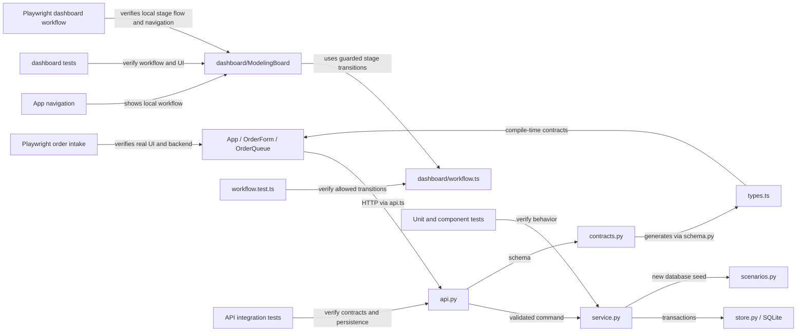

# Phase 1 code map

All paths below exist. Verification commands run from the repo root using the
virtual environment. `python scripts/check.py full` verifies the entire slice;
`coverage` additionally checks application statement/branch coverage.

## Source and test responsibilities

| File | Owned behavior / relationships | Verification |
| --- | --- | --- |
| [backend/print_assist/__init__.py](../backend/print_assist/__init__.py) | Package marker; no initialization side effects. | Backend suite/imports |
| [contracts.py](../backend/print_assist/contracts.py) | Strict quantity/priority, UTC deadlines, command and snapshot schema. Used by API/service and generated frontend types. | `python -m pytest backend/tests/unit/test_orders.py` |
| [scenarios.py](../backend/print_assist/scenarios.py) | Deterministic empty-orders seed with one print-ready artifact reference. Printers arrive in Phase 2. | Service/API tests |
| [store.py](../backend/print_assist/store.py) | SQLite transactions, snapshot storage, command-result table and connection lifetime. | Store/service tests |
| [service.py](../backend/print_assist/service.py) | One-owner authoritative intake, session/revision checks, idempotency and atomic order/events. | `python -m pytest backend/tests/unit/test_service.py` |
| [api.py](../backend/print_assist/api.py) | Offline app factory, health/state/order routes, validation/conflict responses. | `python -m pytest backend/tests/integration` |
| [backend/tests/conftest.py](../backend/tests/conftest.py) | Shared order fixture and outbound socket guard (numeric loopback allowed). | Backend suite |
| [test_orders.py](../backend/tests/unit/test_orders.py) | Invalid inputs and normalized/equal-boundary deadlines. | Backend unit suite |
| [test_service.py](../backend/tests/unit/test_service.py) | Persistence, replay, unknown artifacts, concurrent conflicts, detached snapshots and restart invalidation. | Backend unit suite |
| [test_store.py](../backend/tests/unit/test_store.py) | Transaction exit closes a real SQLite connection. | Backend unit suite |
| [test_checks.py](../backend/tests/unit/test_checks.py) | Root runner executes subprocesses and propagates failure without continuing. | Backend unit suite |
| [test_orders_api.py](../backend/tests/integration/test_orders_api.py) | Real app/SQLite HTTP behavior, response schema, offline operation with fake credentials. | Backend integration suite |
| [frontend/src/main.tsx](../frontend/src/main.tsx) | DOM mounting and stylesheet import only. | Browser test/build |
| [App.tsx](../frontend/src/App.tsx) | Dashboard/Orders navigation, state loading, retry key ownership, stale-response suppression, save reconciliation against current session/revision, and queue/form composition. | App tests, modeling dashboard |
| [api.ts](../frontend/src/api.ts) | HTTP transport and actionable save/load errors. | Frontend transport tests |
| [types.ts](../frontend/src/types.ts) | Generated OpenAPI types; do not hand-edit. | `python scripts/schema.py --check` |
| [styles.css](../frontend/src/styles.css) | Responsive visual layout for dashboard workflow, navigation, intake, and queue. No business logic. | Build/browser review |
| [OrderForm.tsx](../frontend/src/components/OrderForm.tsx) | Inputs, UTC command payload, busy/error states, preservation on failure. | Frontend OrderForm tests |
| [OrderQueue.tsx](../frontend/src/components/OrderQueue.tsx) | Empty state, saved quantity/deadlines/status and completion display. | Frontend OrderQueue tests |
| [test-setup.ts](../frontend/src/test-setup.ts) | DOM cleanup, mock restoration and default fetch denial. | Frontend suite |
| [test-fixtures.ts](../frontend/src/test-fixtures.ts) | Complete typed empty/ordered snapshot fixtures. | Frontend suite/typecheck |
| [App.test.tsx](../frontend/src/App.test.tsx) | Load/save/refresh, overlapping refresh/save, retry key reuse, busy state, late success/failure handling. | `npm test` |
| [api.test.ts](../frontend/src/api.test.ts) | Transport command body and load/conflict/validation errors. | `npm test` |
| [OrderForm.test.tsx](../frontend/src/components/OrderForm.test.tsx) | Submit payload, rejected-input preservation and invalid deadline feedback. | `npm test` |
| [OrderQueue.test.tsx](../frontend/src/components/OrderQueue.test.tsx) | Empty and saved order presentation. | `npm test` |
| [ModelingBoard.tsx](../frontend/src/dashboard/ModelingBoard.tsx) | Operator-facing local workflow board, task intake, stage actions, and review outcomes. Does not generate models or supports. | ModelingBoard tests, workflow module |
| [workflow.ts](../frontend/src/dashboard/workflow.ts) | Validates deterministic task creation and modeling/supports/review/approval transitions. No inference or persistence. | `workflow.test.ts` |
| [ModelingBoard.test.tsx](../frontend/src/dashboard/ModelingBoard.test.tsx) | Verifies dashboard stage progression, approval, and revision return. | `npm test` |
| [workflow.test.ts](../frontend/src/dashboard/workflow.test.ts) | Verifies required inputs, allowed transitions, and invalid action rejection. | `npm test` |
| [scripts/check.py](../scripts/check.py) | Portable unit/full/coverage orchestration; short-circuits on failure; per-run outputs. | Runner unit tests and all three check modes |
| [scripts/schema.py](../scripts/schema.py) | Offline OpenAPI generation, TS generation and drift check in temporary storage. | Full/coverage modes |
| [order-intake.spec.ts](../tests/e2e/order-intake.spec.ts) | Browser-to-real-backend creation and reload persistence; fails external requests. | `npm run e2e` |
| [modeling-dashboard.spec.ts](../tests/e2e/modeling-dashboard.spec.ts) | Verifies local modeling/support/review transitions, navigation retention, and zero external requests. | `npm run e2e` |

## Configuration and documentation

| File | Responsibility | Verification |
| --- | --- | --- |
| [.gitignore](../.gitignore) | Exclude credentials, runtime data, tools, caches and generated outputs. | Git status/check-ignore |
| [.node-version](../.node-version) | Reference Node version. | `node --version` |
| [.python-version](../.python-version) | Reference Python version. | `python --version` |
| [pyproject.toml](../pyproject.toml) | Runtime/test dependencies, pytest paths, application coverage gate. | Locked sync/backend checks |
| [uv.lock](../uv.lock) | Resolved Python versions/hashes. | `uv sync --locked --extra test` |
| [package.json](../package.json) | npm workspace commands and browser/schema dependencies. | `npm ci`, full checks |
| [package-lock.json](../package-lock.json) | Resolved JS versions/integrities. | `npm ci` |
| [frontend/package.json](../frontend/package.json) | React/Vite/TypeScript and component testing dependencies/scripts. | npm tests/build |
| [frontend/tsconfig.json](../frontend/tsconfig.json) | Strict TS/browser compilation. | `npm run build` |
| [frontend/vite.config.ts](../frontend/vite.config.ts) | Loopback dev server/API proxy, DOM tests and coverage inclusion/exclusion. | Full/coverage checks |
| [frontend/index.html](../frontend/index.html) | Browser title, responsive viewport and mount entry. | Browser test/build |
| [playwright.config.ts](../playwright.config.ts) | Test-owned backend/frontend servers, separate DB/output per run. | Browser test and clean exit |
| [development.md](development.md) | Setup, startup/restart, check commands, coverage scope and platform verification matrix. | Links and agreement with executed commands |

Return to the [repository map](knowledge-map.md) for requirements and research.
