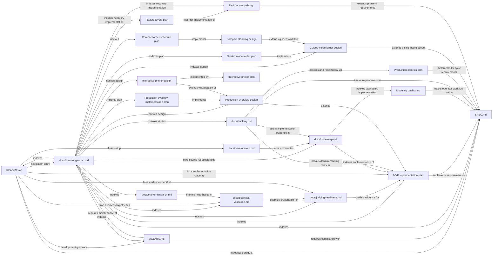

# Repository knowledge map

Start here to find responsibilities and related files. The application implements
offline order intake, persisted modeling, virtual production and interactive printer views. The [code map](code-map.md) indexes every current
source/configuration/test file. Offline fault recovery and impact reports are implemented; live agent orchestration remains planned.

## Current graph

Arrows describe the labeled relationship, not runtime imports.

## File index

| File | Purpose and owned behavior | Related files | Verification |
| --- | --- | --- | --- |
| [README.md](../README.md) | Customer/value overview, planned web stack, honest implementation status, and contributor entry points. No runtime behavior. | Specification, instructions, map, plan, judging checklist, business brief | Check relative links and consistency with spec. |
| [SPEC.md](../SPEC.md) | Customer, business outcomes, MVP scope, proposed architecture, agent controls, TDD policy, acceptance criteria, and pricing hypotheses. Requirements rather than implemented behavior. | README, instructions | Review requirements for consistency; preserve offline development and explicit live-demo gates. |
| [AGENTS.md](../AGENTS.md) | Contributor/agent rules for branches, navigation, graph maintenance, tests, and authorization boundaries. No automated branch enforcement. | Specification, map | Compare rules with spec and current workflow. |
| [docs/knowledge-map.md](knowledge-map.md) | This index and relationship graph. No runtime behavior. | All indexed files | Confirm links resolve, entries match files, and edges match inspected relationships. |
| [MVP implementation plan](superpowers/plans/2026-11-13-mvp-implementation.md) | Six test-first milestones and contracts with an implementation audit: Phase 1 implemented, Tasks 2-3 partial, later milestones outstanding. | Specification, instructions, development setup | Review milestone coverage against spec and verify actual results in development setup. |
| [Judging readiness](judging-readiness.md) | User-supplied rubric weights, evidence gaps, financial worksheet guidance, growth limits, and pitch checklist. Preparation rather than achieved scores. | Implementation plan, specification | Check weights total 100%, distinguish assumptions from evidence, verify links. |
| [Business validation](business-validation.md) | Desk-research approach, archived optional interview guide, hypothetical pricing/cost model, evidence gaps, and demo script. No interviews planned or customer validation claimed. | Judging checklist, implementation plan | Verify arithmetic, dated source attribution, assumption labels, and local links. |
| [Market research](market-research.md) | Dated vendor comparison, attributed customer anecdotes, niche hypotheses, pricing implications, and research limits. No scope changes or customer validation claimed. | Business validation brief, specification | Review source links, distinguish old anecdotes from current vendor claims, and validate arithmetic/local links. |
| [Code map](code-map.md) | Exact source, configuration, test, and tooling responsibilities and relationships for order intake, modeling, virtual production and interactive 3D views. | Plan, setup, implementation files | Validate file links and update alongside code. |
| [Development setup](development.md) | Native setup/run/check commands, restart semantics, coverage boundaries and actual platform status. | README, code map | Full check command and local-link review. |
| [Remaining phase backlog](backlog.md) | Nineteen local stories for Phases 2-6 plus a deferred live-adapter story; audited phase status, operator-reported idle/start gap (PA-307), remaining criteria, ownership and spec/plan references. Local IDs, not remote issues. | Implementation plan, specification | Check story coverage, dependencies, links and shared definition of done. |
| [Production overview design](superpowers/specs/2026-11-14-production-overview-design.md) | Approved virtual printers, automatic/manual scheduling, dashboard tabs and AI ownership boundary. | Implementation plan, backlog, specification | Review design against agreed scope and shared contracts. |
| [Production overview implementation plan](superpowers/plans/2026-11-14-production-overview.md) | Test-first tasks and partial-completion audit for virtual printer state, scheduling, dashboard and verification. | Production overview design, code map | Check task coverage against design and update as implementation evolves. |
| [Interactive printer design](superpowers/specs/2026-11-14-interactive-printer-design.md) | Approved 3D printer/bed views, STL part assets and persisted visual associations. | Production overview design, specification, code map | Review contracts, scope and proposed defaults before implementation. |
| [Interactive printer implementation](superpowers/plans/2026-11-14-interactive-printers.md) | Test-first tasks, constraints and recorded implementation choices for 3D views. | Interactive printer design, code map | Full/coverage commands and feature review. |
| [Part model handoff](../frontend/public/models/README.md) | STL convention, catalog registration, limits, example provenance and optional printer replacement notes. | visual_assets.py, modeling form, printer loader | Verify catalog paths and offline browser loading. |
| [Production controls plan](superpowers/plans/2026-11-14-production-controls.md) | Pause/resume/offline/online, deterministic scenario reset, events and retry/session safety; accelerated clock remains subsequent work. | SPEC, MVP plan, backlog, code map | Root coverage/full commands and regression review. |

| [Clock and monitoring plan](superpowers/plans/2026-11-14-clock-monitoring.md) | Single-owner accelerated clock, conservative forecasts and serial live polling. | SPEC, backlog, code map | Root coverage and browser checks. |

| [Dashboard stability plan](superpowers/plans/2026-11-14-dashboard-stability.md) | Stable 3D refresh, friendly labels and compact dashboard based on user visual reference. | Code map, SPEC, production overview | Coverage/browser and layout inspection. |

| [Guided printing plan](superpowers/plans/2026-11-14-guided-printing.md) | Overview inspection, visible simulated printing, prepared-profile intake and guided manual/automatic printing. | SPEC, backlog, handoff, code map | Root coverage and guided browser workflow. |

| [Compact overview plan](superpowers/plans/2026-11-14-compact-overview.md) | Reference-driven header, floor/telemetry, lower table/log and scenario sidebar layout, preserving interactive 3D. | Code map, guided printing plan, SPEC | Root coverage and responsive browser checks. |

| [Schedule proposal/start guidance plan](superpowers/plans/2026-11-14-schedule-proposals.md) | PA-301 future proposals and material commitments, PA-307 idle/new-print guidance and observable playback. | SPEC, backlog, code map | Root offline coverage and proposal browser workflow. |

| [Modeling/support integration plan](superpowers/plans/2026-11-14-modeling-support-integration.md) | Published support assessment, removal and NIST preview integration with existing profiles/printer workflows and legacy upgrade. | SPEC, code map, model handoff | Root coverage, upgrade integration tests and review. |

## How to extend the map

New guided workflow references:

- [Compact order/schedule design](superpowers/specs/2026-11-14-compact-order-schedule-design.md): compact intake, confirmed queued management, calendar axis and incoming simulation; relates to the guided design, SPEC and code map; verify against browser and offline checks.
- [Fault/recovery design](superpowers/specs/2026-11-14-fault-recovery-design.md): implemented offline isolation, redistribution, before/after part/order impacts, persistence and review/automatic simulation policy; relates to SPEC/PA-401/402/403 and inspected scheduler/service. Verify against user requirements and implementation evidence before claiming runtime support.
- [Fault/recovery plan](superpowers/plans/2026-11-14-fault-recovery.md): test-first backend, impact, recovery, dashboard and resettable demo milestones; relates to the design and Phase 4 backlog. Check links/consistency now; root coverage/schema/build/browser checks verify the delivered offline implementation.
- [Compact order/schedule plan](superpowers/plans/2026-11-14-compact-order-schedule.md): test-first tasks, constraints and execution evidence for the refinement; verify using root coverage/schema/build/browser commands.
- [Guided model/order design](superpowers/specs/2026-11-14-guided-model-order-design.md): saved models, bounded STL uploads, example shop feed, reviewed timelines and user navigation; verify against SPEC and workflow browser tests.
- [Guided model/order plan](superpowers/plans/2026-11-14-guided-model-orders.md): test-first backend/UI tasks, guarded contracts, scope and execution evidence; verify using root coverage/schema/build/browser checks.

When implementation begins, add each source/configuration/test file to the table.
Describe what it owns and connect its actual imports, shared contracts, and tests
with labeled graph edges. Include runnable test commands once they exist. Keep
entries concise; split into linked subsystem maps as the index grows, retaining
this page as the top-level entry point.

Read the relevant implementation and tests before editing. Correct stale entries
in the same branch. The map helps locate evidence; it does not prove correctness
or automatically discover dependencies.
