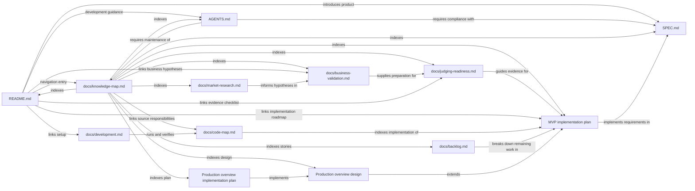

# Repository knowledge map

Start here to find responsibilities and related files. Phase 1 implements offline
order intake and persistence. The [code map](code-map.md) indexes every current
source/configuration/test file. Later runtime architecture remains planned.

## Current graph

Arrows describe the labeled relationship, not runtime imports.

## File index

| File | Purpose and owned behavior | Related files | Verification |
| --- | --- | --- | --- |
| [README.md](../README.md) | Customer/value overview, planned web stack, honest implementation status, and contributor entry points. No runtime behavior. | Specification, instructions, map, plan, judging checklist, business brief | Check relative links and consistency with spec. |
| [SPEC.md](../SPEC.md) | Customer, business outcomes, MVP scope, proposed architecture, agent controls, TDD policy, acceptance criteria, and pricing hypotheses. Requirements rather than implemented behavior. | README, instructions | Review requirements for consistency; preserve offline development and explicit live-demo gates. |
| [AGENTS.md](../AGENTS.md) | Contributor/agent rules for branches, navigation, graph maintenance, tests, and authorization boundaries. No automated branch enforcement. | Specification, map | Compare rules with spec and current workflow. |
| [docs/knowledge-map.md](knowledge-map.md) | This index and relationship graph. No runtime behavior. | All indexed files | Confirm links resolve, entries match files, and edges match inspected relationships. |
| [MVP implementation plan](superpowers/plans/2026-11-13-mvp-implementation.md) | Six test-first milestones and contracts. Phase 1 implemented; later milestones remain planned. | Specification, instructions, development setup | Review milestone coverage against spec and verify actual results in development setup. |
| [Judging readiness](judging-readiness.md) | User-supplied rubric weights, evidence gaps, financial worksheet guidance, growth limits, and pitch checklist. Preparation rather than achieved scores. | Implementation plan, specification | Check weights total 100%, distinguish assumptions from evidence, verify links. |
| [Business validation](business-validation.md) | Desk-research approach, archived optional interview guide, hypothetical pricing/cost model, evidence gaps, and demo script. No interviews planned or customer validation claimed. | Judging checklist, implementation plan | Verify arithmetic, dated source attribution, assumption labels, and local links. |
| [Market research](market-research.md) | Dated vendor comparison, attributed customer anecdotes, niche hypotheses, pricing implications, and research limits. No scope changes or customer validation claimed. | Business validation brief, specification | Review source links, distinguish old anecdotes from current vendor claims, and validate arithmetic/local links. |
| [Code map](code-map.md) | Exact source, configuration, test, and tooling responsibilities and relationships for Phase 1. | Plan, setup, implementation files | Validate file links and update alongside code. |
| [Development setup](development.md) | Native setup/run/check commands, restart semantics, coverage boundaries and actual platform status. | README, code map | Full check command and local-link review. |
| [Remaining phase backlog](backlog.md) | Fifteen Jira-style stories for Phases 2-6 plus a deferred live-adapter story; priorities, dependencies and acceptance criteria. Local IDs, not remote issues. | Implementation plan, specification | Check story coverage, dependencies, links and shared definition of done. |
| [Production overview design](superpowers/specs/2026-11-14-production-overview-design.md) | Approved virtual printers, automatic/manual scheduling, dashboard tabs and AI ownership boundary. | Implementation plan, backlog, specification | Review design against agreed scope and shared contracts. |
| [Production overview implementation plan](superpowers/plans/2026-11-14-production-overview.md) | Test-first tasks for virtual printer state, scheduling, dashboard and verification. | Production overview design, code map | Check task coverage against design and update as implementation evolves. |

## How to extend the map

When implementation begins, add each source/configuration/test file to the table.
Describe what it owns and connect its actual imports, shared contracts, and tests
with labeled graph edges. Include runnable test commands once they exist. Keep
entries concise; split into linked subsystem maps as the index grows, retaining
this page as the top-level entry point.

Read the relevant implementation and tests before editing. Correct stale entries
in the same branch. The map helps locate evidence; it does not prove correctness
or automatically discover dependencies.
