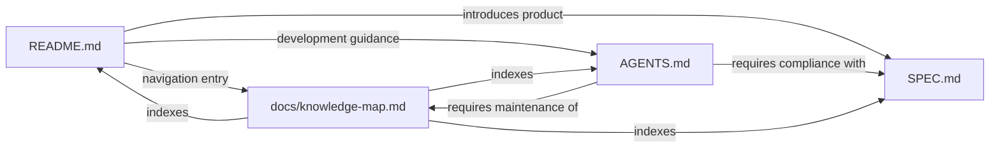

# Repository knowledge map

Start here to find responsibilities and related files. This map describes files
that exist today; there is no application implementation or executable test suite
yet. Runtime architecture proposals are in the specification.

## Current graph

Arrows describe the labeled relationship, not runtime imports.

## File index

| File | Purpose and owned behavior | Related files | Verification |
| --- | --- | --- | --- |
| [README.md](../README.md) | Product introduction and entry points for contributors. No runtime behavior. | Specification, instructions, map | Check relative links and consistency with spec. |
| [SPEC.md](../SPEC.md) | Customer, business outcomes, MVP scope, proposed architecture, agent controls, TDD policy, acceptance criteria, and pricing hypotheses. Requirements rather than implemented behavior. | README, instructions | Review requirements for consistency; preserve offline development and explicit live-demo gates. |
| [AGENTS.md](../AGENTS.md) | Contributor/agent rules for branches, navigation, graph maintenance, tests, and authorization boundaries. No automated branch enforcement. | Specification, map | Compare rules with spec and current workflow. |
| [docs/knowledge-map.md](knowledge-map.md) | This index and relationship graph. No runtime behavior. | All indexed files | Confirm links resolve, entries match files, and edges match inspected relationships. |

## How to extend the map

When implementation begins, add each source/configuration/test file to the table.
Describe what it owns and connect its actual imports, shared contracts, and tests
with labeled graph edges. Include runnable test commands once they exist. Keep
entries concise; split into linked subsystem maps as the index grows, retaining
this page as the top-level entry point.

Read the relevant implementation and tests before editing. Correct stale entries
in the same branch. The map helps locate evidence; it does not prove correctness
or automatically discover dependencies.
